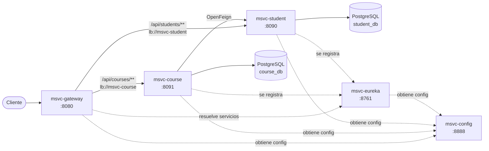
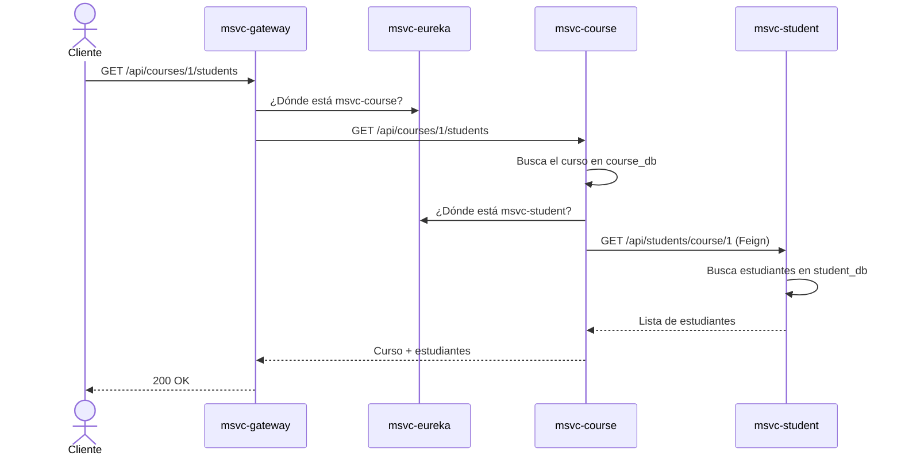

# Student Courses – Microservicios con Spring Cloud

Proyecto de práctica de una arquitectura de microservicios con **Spring Boot 3.5** y **Spring Cloud**. Gestiona cursos y estudiantes en dos servicios independientes, cada uno con su propia base de datos PostgreSQL. Los servicios se comunican entre sí mediante OpenFeign y descubrimiento de servicios con Eureka, detrás de un API Gateway.

## Arquitectura



Cada servicio tiene su propia base de datos y se registra en Eureka. El Gateway y el cliente Feign localizan los servicios por nombre (`lb://`), no por dirección fija.

### Ejemplo: estudiantes de un curso

`GET /api/courses/{courseId}/students` combina datos de los dos servicios:



| Módulo | Puerto | Responsabilidad |
|---|---|---|
| `microservice-gateway` | 8080 | Punto de entrada único. Enruta `/api/courses/**` y `/api/students/**` usando Spring Cloud Gateway (WebFlux). |
| `microservice-eureka` | 8761 | Servidor de descubrimiento (Netflix Eureka). |
| `microservice-student` | 8090 | CRUD de estudiantes y consulta por curso. |
| `microservice-course` | 8091 | CRUD de cursos. Agrega los estudiantes de un curso llamando a `msvc-student` con un cliente Feign. |
| `microservice-config` | 8888 | Spring Cloud Config Server (perfil `native`). Sirve la configuración de todos los servicios desde `src/main/resources/configurations/`. |

## Tecnologías

- Java 21
- Spring Boot 3.5.7, Spring Web, Spring Data JPA / Hibernate
- Spring Cloud: Gateway, Netflix Eureka, OpenFeign, Config
- PostgreSQL + Flyway (migraciones)
- Lombok
- Maven (proyecto multimódulo)

## Diseño de cada servicio

Los servicios de negocio siguen una arquitectura en capas:

```
controller/   → endpoints REST (@RestController)
service/      → interfaz + implementación con la lógica de negocio
persistence/  → repositorios Spring Data JPA
entities/     → entidades JPA
dto/          → objetos de transferencia (solo en msvc-course)
client/       → cliente Feign hacia msvc-student (solo en msvc-course)

resources/db/migration/  → migraciones Flyway (esquema y datos de ejemplo)
```

## Endpoints (a través del gateway, puerto 8080)

### Estudiantes
| Método | Ruta | Descripción |
|---|---|---|
| GET | `/api/students` | Lista todos los estudiantes |
| GET | `/api/students/{id}` | Obtiene un estudiante |
| GET | `/api/students/course/{id}` | Estudiantes inscritos en un curso |
| POST | `/api/students` | Crea un estudiante |

### Cursos
| Método | Ruta | Descripción |
|---|---|---|
| GET | `/api/courses` | Lista todos los cursos |
| GET | `/api/courses/{id}` | Obtiene un curso |
| GET | `/api/courses/{courseId}/students` | Curso con su profesor y la lista de estudiantes (comunicación entre servicios) |
| POST | `/api/courses` | Crea un curso |

Ejemplo de respuesta de `GET /api/courses/1/students`:

```json
{
  "courseName": "Matematicas",
  "teacherName": "Profesor A",
  "students": [
    { "id": 1, "name": "Juan", "lastName": "Perez", "email": "jua.perez@example.com", "courseId": 1 },
    { "id": 4, "name": "Ana", "lastName": "Martínez", "email": "ana.mar@example.com", "courseId": 1 }
  ]
}
```

### Errores

Los errores se devuelven con el formato estándar `ProblemDetail` (RFC 9457, `Content-Type: application/problem+json`):

| Código | Cuándo |
|---|---|
| 404 Not Found | El estudiante o curso con ese ID no existe (`/api/students/{id}`, `/api/courses/{id}`, `/api/courses/{courseId}/students`) |
| 503 Service Unavailable | `/api/courses/{courseId}/students` no puede contactar con `msvc-student` (caído o no registrado en Eureka) |

Ejemplo de `GET /api/courses/999`:

```json
{
  "type": "about:blank",
  "title": "Resource not found",
  "status": 404,
  "detail": "Course with id 999 not found",
  "instance": "/api/courses/999"
}
```

## Cómo ejecutarlo

### 1. Base de datos

Crea las dos bases de datos vacías en PostgreSQL:

```sql
CREATE DATABASE course_db;
CREATE DATABASE student_db;
```

Al arrancar, cada servicio aplica con **Flyway** las migraciones de `src/main/resources/db/migration/`:

| Migración | Qué hace |
|---|---|
| `V1__create_<tabla>_table.sql` | Crea la tabla |
| `V2__insert_sample_<tabla>.sql` | Carga los datos de ejemplo |

Flyway registra las migraciones aplicadas en la tabla `flyway_schema_history`, así que cada una se ejecuta una sola vez. Para cambiar el esquema, añade una migración nueva (`V3__...sql`). No modifiques las que ya se aplicaron.

> Si creaste las tablas a mano con una versión anterior de este README, Flyway no arrancará sobre ese esquema. Borra y vuelve a crear las bases de datos (`DROP DATABASE course_db;` y `DROP DATABASE student_db;`).

### 2. Configuración

Toda la configuración está centralizada en el Config Server, en `microservice-config/src/main/resources/configurations/`:

| Archivo | Lo usa |
|---|---|
| `application.yml` | Todos los servicios (URL de Eureka) |
| `msvc-<servicio>.yml` | Solo ese servicio (puerto, base de datos, rutas del gateway…) |

El `application.yml` de cada servicio solo contiene su nombre y el `import` obligatorio del Config Server. Si el Config Server no está arriba, el servicio no arranca.

Los valores sensibles o que dependen del entorno se leen de variables de entorno. Si una variable no está definida, se usa el valor por defecto, pensado para desarrollo local:

| Variable | Por defecto | Usada por |
|---|---|---|
| `DB_HOST` | `localhost` | student, course |
| `DB_PORT` | `5432` | student, course |
| `DB_USERNAME` | `postgres` | student, course |
| `DB_PASSWORD` | `root` | student, course |
| `EUREKA_URL` | `http://localhost:8761/eureka` | todos los clientes de Eureka |
| `CONFIG_SERVER_URL` | `http://localhost:8888` | todos los servicios |

El Config Server devuelve los `${...}` sin resolver, y cada servicio los sustituye con sus propias variables de entorno. Así, las contraseñas reales nunca se guardan en el Config Server ni en el repositorio:

```bash
DB_PASSWORD=mi-clave ./mvnw spring-boot:run
```

### 3. Arrancar los servicios (en este orden)

```bash
cd microservice-config  && ./mvnw spring-boot:run   # 1. Configuración centralizada
cd microservice-eureka  && ./mvnw spring-boot:run   # 2. Registro de servicios
cd microservice-student && ./mvnw spring-boot:run   # 3.
cd microservice-course  && ./mvnw spring-boot:run   # 4.
cd microservice-gateway && ./mvnw spring-boot:run   # 5. Punto de entrada
```

Para ver la configuración que recibe un servicio: `curl http://localhost:8888/msvc-course/default`.

Cuando todo esté arriba, el panel de Eureka en http://localhost:8761 debe mostrar `MSVC-STUDENT`, `MSVC-COURSE` y `MSVC-GATEWAY` registrados.

## Próximos pasos

- Agregar pruebas unitarias con JUnit 5 y Mockito para la capa de servicio.
- Dockerizar los servicios con `docker-compose`.
